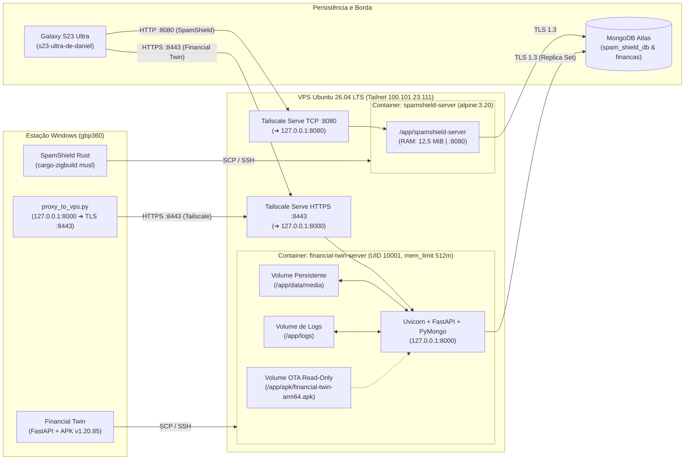

# Nota Técnica de Engenharia e Operações: Implantação em Produção (VPS Cloud + Tailscale Mesh)

**Documento:** `NT-OPS-2026-001` (Rev. 3 — Multi-Serviço Endurecido: SpamShield BR + Financial Twin)  
**Projetos:**
- **SpamShield BR** (`spamshield-server` & Distribuição OTA `v1.2.9` Build `13`)
- **Financial Digital Twin** (`financial-twin-server` & Distribuição OTA `v1.20.86` Build `132`)  
**Data:** 14 de Novembro de 2026  
**Status:** Produção Ativa (`ONLINE` — Coexistência Multi-Container Endurecida)  

---

## 1. Sumário Executivo

Esta Nota Técnica documenta a arquitetura de compilação, empacotamento em containers isolados e implantação endurecida em nuvem dos backends **SpamShield BR (`spamshield-server`)** e **Financial Digital Twin (`financial-twin-server`)** coexistindo na mesma instância VPS Linux de recursos restritos (**1 vCPU / 1 GB RAM**).

1. **SpamShield BR (`spamshield-server`):** Compilação cruzada estática no host Windows (`x86_64-pc-windows-msvc` ➔ `x86_64-unknown-linux-musl`) utilizando **Zig (`0.13.0`)** e **Rustls**, empacotado em imagem `alpine:3.20` (`34,5 MB`).
2. **Financial Digital Twin (`financial-twin-server`):** Empacotamento determinístico da árvore de fontes FastAPI/Uvicorn/PyMongo + definição endurecida de container (`deploy/vps/`) via `Build-OraclePackage.py` (`83 arquivos`, SHA-256 `10004b7d14d847a4d233aa61caeec2fa883a4d3d60e79dc224ed210a32ca678d`), execução em container não-root (`10001:10001`, `cap_drop: ALL`, `no-new-privileges:true`, `mem_limit: 512m`, `pids_limit: 128`) vinculado exclusivamente ao loopback (`127.0.0.1:8000:8000`) atrás do proxy TLS **Tailscale Serve (`:8443`)**.

> [!IMPORTANT]
> **Resultado Operacional Consolidado em Produção:** Ambos os servidores operam simultaneamente na VPS dentro do orçamento físico de **956 MiB de RAM**:
> - `spamshield-server`: **12,57 MiB RAM (1,31%)** | Porta `:8080` (Tailscale TCP Proxy)
> - `financial-twin-server`: **~109 MiB RAM idle (`mem_limit: 512m`)** | Porta `:8443` (Tailscale HTTPS Serve Proxy ➔ `127.0.0.1:8000`)

---

## 2. Diagnóstico de Pré-Implantação e Decisões de Arquitetura

### 2.1. Restrições Identificadas e Soluções Adotadas
1. **Hardware da VPS Alvo e Contenção contra OOM Killer:** Instância DigitalOcean (`ubuntu-s-1vcpu-1gb-nyc1`) com **1 vCPU** e **956 MiB de RAM física**.
   - Para o **SpamShield (Rust)**, adotou-se *cross-compilation* estática local via `cargo-zigbuild`.
   - Para o **Financial Twin (Python 3.12 / FastAPI)**, instalou-se a pilha travada (`requirements.lock.txt`, com `dnspython==2.9.2`, `defusedxml==0.7.1` e `uvloop==0.22.1`) em imagem `python:3.12-slim` sob usuário dedicado `appuser` (`10001:10001`), com limites `mem_limit: 512m` e `pids_limit: 128` no Docker Compose e semáforo unificado de memória/IA no processo.
2. **Isolamento de Rede (`127.0.0.1:8000:8000`) e Transporte Privado TLS (`:8443`):**
   - No Linux, publicar `- "8000:8000"` no Docker injeta regras `DNAT` antes do UFW, expondo a porta na internet pública. Por isso, `deploy/vps/docker-compose.yml` vincula estritamente **`127.0.0.1:8000:8000`**, tornando o serviço inacessível por `eth0` (IPv4/IPv6 públicos) e acessível **exclusivamente** via `tailscale serve` HTTPS (`https://ubuntu-s-1vcpu-1gb-nyc1.tail1093e7.ts.net:8443` ➔ `http://127.0.0.1:8000`).
   - No desktop Windows (`Abrir-Financeiro-Desktop.ps1`), `mobile/desktop-dist` (`v1.20.86`) aponta para `http://127.0.0.1:8000`, onde `scripts/proxy_to_vps.py` atua como relay local estrito (loopback `127.0.0.1:8000`) encaminhando todas as chamadas sobre **TLS 1.2+ verificado** para `https://ubuntu-s-1vcpu-1gb-nyc1.tail1093e7.ts.net:8443` (nunca para o IP público em HTTP puro).
3. **Relocação de Caminhos de Mídia Windows ➔ Linux no MongoDB (`financas`):**
   - Os arquivos de `data/media` residem em `/opt/financial-twin/data/media` na VPS, mapeados para `/app/data/media/<sha256>` com propriedade `10001:10001` e reconciliação protegida contra condições de corrida (`media_store.py`).

---

## 3. Especificações dos Ambientes (Dados Reais Levantados)

### 3.1. Máquina de Build (Host Local)
| Parâmetro | Especificação |
| :--- | :--- |
| **Sistema Operacional** | Windows (`x86_64-pc-windows-msvc`) |
| **Toolchain Rust (SpamShield)** | `rustc 1.93.1` + `Zig 0.13.0` + `cargo-zigbuild v0.24.0` (`x86_64-unknown-linux-musl`) |
| **Toolchain Python / Mobile (Financial)** | `Python 3.12` + `Expo / React Native` + `Android SDK 36` (`arm64-v8a`) |

### 3.2. Servidor de Produção (VPS Cloud)
| Parâmetro | Especificação |
| :--- | :--- |
| **Provedor / Hostname** | DigitalOcean NYC1 — `ubuntu-s-1vcpu-1gb-nyc1` |
| **Sistema Operacional** | Ubuntu 26.04.1 LTS (GNU/Linux `7.0.0-42-generic x86_64`) |
| **CPU / Memória / Swap** | 1 vCPU / 956 MiB RAM / 2,0 GiB Swap |
| **Armazenamento (`/dev/vda1`)** | 24 GB SSD (6,1 GB em uso — **27% ocupado**, 18 GB livres) |
| **IPv4 Público (`eth0`)** | `198.199.65.103` *(porta `:8000` bloqueada por bind em `127.0.0.1`)* |
| **IPv6 Público (`eth0`)** | `2604:a880:400:d1:0:5:4ed1:a001` |
| **Engine de Containers** | Docker Engine `v29.9.2` (build `a82e528`) + Docker Compose `v5.6.1` |

### 3.3. Topologia da Rede Privada (Tailscale Tailnet)
| Nó / Dispositivo | Papel na Arquitetura | IPv4 Tailscale (CGNAT) | MagicDNS FQDN |
| :--- | :--- | :--- | :--- |
| `ubuntu-s-1vcpu-1gb-nyc1` | **Servidor Produção (VPS)** | `100.101.23.111` | `ubuntu-s-1vcpu-1gb-nyc1.tail1093e7.ts.net` |
| `s23-ultra-de-daniel` | **Cliente Edge Android** | `100.77.79.105` | `s23-ultra-de-daniel.tail1093e7.ts.net` |
| `gbp360` | **Estação de Build / Desktop (PC)** | `100.83.253.15` | `gbp360.tail1093e7.ts.net` |

---

## 4. Arquitetura Consolidada de Compilação e Implantação



---

## 5. Estrutura e Configuração dos Serviços na VPS

### 5.1. Serviço 1: SpamShield BR (`/opt/spamshield`)
```text
/opt/spamshield/
├── .env                  # Segredos e URI MongoDB (spam_shield_db)
├── Dockerfile            # Imagem alpine:3.20 + ca-certificates + tzdata
├── docker-compose.yml    # Container spamshield-server (:8080)
├── spamshield-server     # Binário ELF estático (x86_64-unknown-linux-musl)
└── apk/
    ├── app-debug.apk         # Pacote Android v1.2.9 (Build 13)
    └── output-metadata.json
```

### 5.2. Serviço 2: Financial Digital Twin (`/opt/financial-twin`)
```text
/opt/financial-twin/
├── .env                  # Segredos de produção, JWT_SECRET, XAI_API_KEY e URI MongoDB (financas)
├── Dockerfile            # Imagem python:3.12-slim não-root (10001:10001) + requirements.lock.txt
├── docker-compose.yml    # Bind 127.0.0.1:8000:8000 + cap_drop ALL + mem_limit 512m + pids_limit 128
├── backend/              # Código-fonte FastAPI/PyMongo empacotado via Build-OraclePackage.py
├── data/
│   └── media/            # Comprovantes/extratos endereçados por SHA-256 (chown 10001:10001)
├── logs/                 # Telemetria local fora do Git (chown 10001:10001)
└── apk/
    ├── financial-twin-arm64.apk             # Pacote Android v1.20.85 (Build 131)
    ├── financial-twin-arm64.manifest.json   # Manifesto verificado (SHA-256 + tamanho + signer)
    ├── financial-twin-1.20.85.provenance.json
    └── apk-info.json                        # Metadados OTA autenticados
```

#### `Dockerfile` (`deploy/vps/Dockerfile` ➔ `/opt/financial-twin/Dockerfile`)
```dockerfile
FROM python:3.12-slim

RUN apt-get update \
    && apt-get install -y --no-install-recommends ca-certificates tzdata \
    && rm -rf /var/lib/apt/lists/* \
    && groupadd --gid 10001 appuser \
    && useradd --uid 10001 --gid 10001 --create-home --shell /usr/sbin/nologin appuser

WORKDIR /app
COPY backend/requirements.txt backend/requirements.lock.txt /app/backend/
RUN pip install --no-cache-dir -r backend/requirements.txt -c backend/requirements.lock.txt

COPY backend/ /app/backend/
RUN mkdir -p /app/data/media /app/logs /app/apk \
    && chown -R appuser:appuser /app

USER 10001:10001
EXPOSE 8000
ENV PYTHONUNBUFFERED=1
ENV PYTHONDONTWRITEBYTECODE=1
ENV PYTHONPATH=/app/backend
ENTRYPOINT ["python", "/app/backend/run_server.py"]
```

#### `docker-compose.yml` (`deploy/vps/docker-compose.yml` ➔ `/opt/financial-twin/docker-compose.yml`)
```yaml
services:
  financial-twin:
    build: .
    container_name: financial-twin-server
    restart: unless-stopped
    user: "10001:10001"
    security_opt:
      - no-new-privileges:true
    cap_drop:
      - ALL
    mem_limit: 512m
    pids_limit: 128
    ports:
      - "127.0.0.1:8000:8000"
    env_file:
      - .env
    volumes:
      - ./data/media:/app/data/media
      - ./logs:/app/logs
      - ./apk:/app/apk:ro
```

### 5.3. Roteamento Tailscale Serve na VPS (`tailscale serve status`)
```text
|-- tcp://ubuntu-s-1vcpu-1gb-nyc1.tail1093e7.ts.net:8080 (tailnet only)
|-- tcp://100.101.23.111:8080
|-- tcp://[fd7a:115c:a1e0::cc33:1770]:8080
|--> tcp://127.0.0.1:8080

https://ubuntu-s-1vcpu-1gb-nyc1.tail1093e7.ts.net:8443 (tailnet only)
|-- / proxy http://127.0.0.1:8000
```

---

## 6. Métricas de Desempenho, Integridade e Validação

### 6.1. Auditoria de Artefatos Prontos para Produção (`v1.20.85`)

| Métrica / Artefato | SpamShield BR (`spamshield-server`) | Financial Twin (`financial-twin-server`) |
| :--- | :--- | :--- |
| **Versão do APK OTA** | `v1.2.9` (Build `13` — `61.049.783 bytes`) | `v1.20.86` (Build `132` — `48.166.940 bytes`) |
| **SHA-256 do APK OTA** | `7a77ab97aabbebebd1e4f5530100bf1eb578b03d6dd76431c4b6edc9f3636632` | `BF8F574F4081DEA2A6ED255E0B624D07B7B550CD9FA708871EE094C4008D2F9E` |
| **Certificado Assinante (`SEC02`)** | — | `71F7B221100670BEC8448A2DA69FE39747F0BCC0A6C883A03AB21D068CF0A552` (`RSA-4096`) |
| **SHA-256 Provenance JSON** | — | `249C70591B4BB5F22790B8E6283FE6CFFC3B303B62E61FAAC6477A81742E364D` |
| **Pacote Backend VPS (`.tar.gz`)** | ELF estático (`x86_64-unknown-linux-musl`) | `financial-twin-vps-hardened-1.20.86-20261114.tar.gz` (`83` arquivos, SHA-256 `266d13a678f69582eb4085b0e1e0937877db1c3f3e9062f4185f7df8a977e426`) |
| **Isolamento do Container** | `alpine:3.20` (`:8080` Tailnet) | `127.0.0.1:8000:8000`, UID `10001`, `cap_drop: ALL`, `mem_limit: 512m`, `pids_limit: 128` |
| **Banco de Dados MongoDB Atlas** | `spam_shield_db` (`connected: true`) | `financas` (`connected`) |

### 6.2. Contrato das Rotas de Saúde e OTA (`:8443`)

1. **Verificação de Saúde (`GET /health`):**
   ```json
   {
     "status": "ok",
     "mongodb": "connected",
     "auth_required": true
   }
   ```
2. **Verificação Autenticada do Atualizador Interno (`GET /v1/app-update`):**
   - Exige sessão válida (`Authorization: Bearer <jwt>`), retorna `size_bytes: 48166944` e `sha256: "4875F6F9A09C5EEB12C2433C3EBEBE441055218F8F77E823FE9F9FA4E855CFC3"`, além de URL assinada de curta duração para download verificado por SHA-256 no cliente Android (`AppUpdate.tsx`).
   - Documentação interativa (`/docs`, `/redoc`, `/openapi.json`) permanece desabilitada em produção.

---

## 7. Procedimento Operacional Padrão (Runbooks de Atualização)

> [!WARNING]
> **Higiene pós-exposição histórica da porta `:8000`:** Caso credenciais ou sessões tenham trafegado anteriormente por `http://198.199.65.103:8000` antes do bind em `127.0.0.1:8000:8000`, recomenda-se após subir o novo pacote rotacionar `JWT_SECRET` em `/opt/financial-twin/.env` e alterar a senha da conta pelo aplicativo conectado via HTTPS Tailscale (`:8443`).

### 7.1. Implantação Imediata da Release `v1.20.86` Endurecida (`financial-twin-server` + APK OTA `RSA-4096`)
```powershell
# A partir de um terminal PowerShell do host Windows conectado à Tailnet (comando único):
powershell -NoProfile -ExecutionPolicy Bypass -File C:\Users\danie\FIN\Publicar-VPS.ps1
```

### 7.2. Gerar Futuros Pacotes e Releases do Financial Digital Twin
```powershell
# 1. Empacotar backend + deploy/vps/ (Dockerfile e docker-compose.yml endurecidos)
cd C:\Users\danie\FIN\financial-app
$pkg = "deploy\packages\financial-twin-vps-$(Get-Date -Format 'yyyyMMdd-HHmmss').tar.gz"
.\.venv\Scripts\python.exe scripts\Build-OraclePackage.py --output $pkg

# 2. Compilar, assinar e publicar APK com manifesto e proveniência estritos (padrão)
cd C:\Users\danie\FIN\financial-app\mobile
.\scripts\build-android.ps1 -NoPush

# 3. (Opcional — SEC02) Gerar keystore dedicado de release quando desejar rotacionar o certificado:
# ..\scripts\New-ReleaseKeystore.ps1
# .\scripts\build-android.ps1 -AllowSignerRotation -NoPush
```

### 7.3. Atualização do SpamShield BR (`spamshield-server` + APK OTA)
```powershell
# 1. Compilar o servidor Rust no Windows visando Linux estático (musl)
cd C:\Users\danie\spamshield\spamshield-server
cargo zigbuild --release --target x86_64-unknown-linux-musl

# 2. Transferir o novo executável Linux para a VPS e reiniciar o container
scp target/x86_64-unknown-linux-musl/release/spamshield-server root@100.101.23.111:/opt/spamshield/
ssh root@100.101.23.111 "cd /opt/spamshield && docker compose up -d --build"
```
