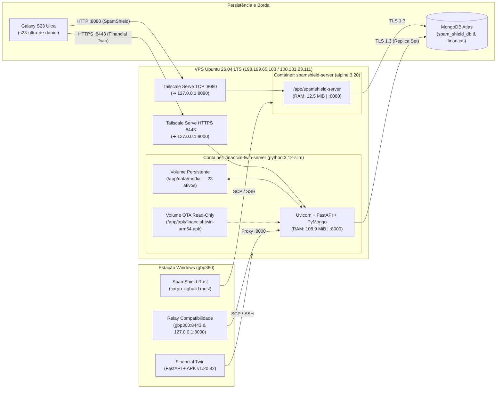

# Nota Técnica de Engenharia e Operações: Implantação em Produção (VPS Cloud + Tailscale Mesh)

**Documento:** `NT-OPS-2026-001` (Rev. 2 — Multi-Serviço: SpamShield BR + Financial Twin)  
**Projetos:**
- **SpamShield BR** (`spamshield-server` & Distribuição OTA `v1.2.9` Build `13`)
- **Financial Digital Twin** (`financial-twin-server` & Distribuição OTA `v1.20.82` Build `128`)  
**Data:** 29 de Outubro de 2026  
**Status:** Produção Ativa (`ONLINE` — Coexistência Multi-Container)  

---

## 1. Sumário Executivo

Esta Nota Técnica documenta a arquitetura de compilação, empacotamento em containers isolados e implantação em nuvem dos backends **SpamShield BR (`spamshield-server`)** e **Financial Digital Twin (`financial-twin-server`)** coexistindo na mesma instância VPS Linux de recursos restritos (**1 vCPU / 1 GB RAM**).

1. **SpamShield BR (`spamshield-server`):** Compilação cruzada estática no host Windows (`x86_64-pc-windows-msvc` ➔ `x86_64-unknown-linux-musl`) utilizando **Zig (`0.13.0`)** e **Rustls**, empacotado em imagem `alpine:3.20` (`34,5 MB`).
2. **Financial Digital Twin (`financial-twin-server`):** Empacotamento determinístico da árvore de fontes FastAPI/Uvicorn/PyMongo via `Build-OraclePackage.py` (`76 arquivos`), execução em container `python:3.12-slim` com `uvloop`/`httptools`, migração integral de comprovantes (`data/media`) e relocação auditada/reversível de caminhos absolutos Windows ➔ Linux (`/app/data/media/<sha256>`) no MongoDB Atlas (`financas`).

> [!IMPORTANT]
> **Resultado Operacional Consolidado em Produção:** Ambos os servidores operam simultaneamente na VPS utilizando no total apenas **311 MiB de RAM usada no host (644 MiB disponíveis de 956 MiB)**:
> - `spamshield-server`: **12,57 MiB RAM (1,31%)** | Porta `:8080` (Tailscale TCP Proxy)
> - `financial-twin-server`: **108,9 MiB RAM (11,39%)** | Porta `:8443` (Tailscale HTTPS Serve Proxy ➔ `:8000`)

---

## 2. Diagnóstico de Pré-Implantação e Decisões de Arquitetura

### 2.1. Restrições Identificadas e Soluções Adotadas
1. **Hardware da VPS Alvo:** Instância DigitalOcean (`ubuntu-s-1vcpu-1gb-nyc1`) com **1 vCPU** e **956 MiB de RAM física**.
   - Para o **SpamShield (Rust)**, compilar mais de 180 crates na VPS causaria *OOM Killer*; adotou-se *cross-compilation* estática local via `cargo-zigbuild`.
   - Para o **Financial Twin (Python 3.12 / FastAPI)**, instalou-se a pilha travada (`requirements.lock.txt`) em imagem `python:3.12-slim` com worker único assíncrono (`uvloop` + `httptools`), mantendo o consumo de memória na casa de ~108 MiB.
2. **Segurança de Transporte Exigida pelo Cliente Mobile (`requirePrivateTransport`) e Retrocompatibilidade (`502 Bad Gateway`):**
   - Enquanto o `SpamShieldApp` opera sobre HTTP em `*.ts.net:8080` validado por `TailscaleCleartext.kt`, o cliente React Native do **Financial Twin** exige estritamente protocolo `https:` para qualquer host remoto (`utils/authState.ts`).
   - **Ação Corretiva Primária:** Configuração do **Tailscale Serve HTTPS** na VPS na porta `8443` (`https://ubuntu-s-1vcpu-1gb-nyc1.tail1093e7.ts.net:8443` ➔ `http://127.0.0.1:8000`), com certificado TLS provisionado automaticamente para a tailnet privada.
   - **Ação Corretiva de Transição (Prevenção de `502 Bad Gateway`):** Clientes na versão `v1.20.81` e o Web Desktop ainda apontavam para `https://gbp360.tail1093e7.ts.net:8443` e `http://127.0.0.1:8000`. Para evitar erro `502` após desligar o processo local do backend no Windows, o proxy `tailscale serve` do PC (`gbp360:8443`) e o relay assíncrono `scripts/proxy_to_vps.py` (`127.0.0.1:8000`) foram apontados diretamente para `http://198.199.65.103:8000` na VPS, garantindo zero escrita duplicada e transição transparente até a atualização OTA para a `v1.20.82`.
3. **Relocação de Caminhos de Mídia Windows ➔ Linux no MongoDB (`financas`):**
   - O banco `financas` registrava caminhos absolutos do Windows (`C:\Users\danie\FIN\financial-app\data\media\<sha256>`) em `media_assets.path`, `capture_batches.storage_key` e `raw_events`.
   - **Ação Corretiva:** Pausa do supervisor local no Windows para evitar dupla escrita (*split-brain*), transferência integral dos arquivos de `data/media` para `/opt/financial-twin/data/media` na VPS e relocação atômica no MongoDB para `/app/data/media/<sha256>` (preservando os caminhos originais em `original_windows_path` / `original_windows_storage_key`). A rotina `reconcile_media(db)` aferiu **`checked: 23, missing: 0`**.

---

## 3. Especificações dos Ambientes (Dados Reais Levantados)

### 3.1. Máquina de Build (Host Local)
| Parâmetro | Especificação |
| :--- | :--- |
| **Sistema Operacional** | Windows (`x86_64-pc-windows-msvc`) |
| **Toolchain Rust (SpamShield)** | `rustc 1.93.1` + `Zig 0.13.0` + `cargo-zigbuild v0.24.0` (`x86_64-unknown-linux-musl`) |
| **Toolchain Python / Mobile (Financial)** | `Python 3.12` + `Expo / React Native` + `Android SDK 36` (`arm64-v8a`) |

### 3.2. Servidor de Produção (VPS Cloud)
| Parâmetro | Especificação |
| :--- | :--- |
| **Provedor / Hostname** | DigitalOcean NYC1 — `ubuntu-s-1vcpu-1gb-nyc1` |
| **Sistema Operacional** | Ubuntu 26.04.1 LTS (GNU/Linux `7.0.0-42-generic x86_64`) |
| **CPU / Memória / Swap** | 1 vCPU / 956 MiB RAM (644 MiB disponíveis com ambos os serviços ativos) / 2,0 GiB Swap |
| **Armazenamento (`/dev/vda1`)** | 24 GB SSD (6,1 GB em uso — **27% ocupado**, 18 GB livres) |
| **IPv4 Público (`eth0`)** | `198.199.65.103` |
| **IPv6 Público (`eth0`)** | `2604:a880:400:d1:0:5:4ed1:a001` |
| **Engine de Containers** | Docker Engine `v29.9.2` (build `a82e528`) + Docker Compose `v5.6.1` |

### 3.3. Topologia da Rede Privada (Tailscale Tailnet)
| Nó / Dispositivo | Papel na Arquitetura | IPv4 Tailscale (CGNAT) | MagicDNS FQDN |
| :--- | :--- | :--- | :--- |
| `ubuntu-s-1vcpu-1gb-nyc1` | **Servidor Produção (VPS)** | `100.101.23.111` | `ubuntu-s-1vcpu-1gb-nyc1.tail1093e7.ts.net` |
| `s23-ultra-de-daniel` | **Cliente Edge Android** | `100.77.79.105` | `s23-ultra-de-daniel.tail1093e7.ts.net` |
| `gbp360` | **Estação de Build (PC)** | `100.83.253.15` | `gbp360.tail1093e7.ts.net` |

---

## 4. Arquitetura Consolidada de Compilação e Implantação



---

## 5. Estrutura e Configuração dos Serviços na VPS

### 5.1. Serviço 1: SpamShield BR (`/opt/spamshield`)
```text
/opt/spamshield/
├── .env                  # Segredos e URI MongoDB (spam_shield_db)
├── Dockerfile            # Imagem alpine:3.20 + ca-certificates + tzdata
├── docker-compose.yml    # Container spamshield-server (:8080)
├── spamshield-server     # Binário ELF estático (x86_64-unknown-linux-musl)
└── apk/
    ├── app-debug.apk         # Pacote Android v1.2.9 (Build 13)
    └── output-metadata.json
```

### 5.2. Serviço 2: Financial Digital Twin (`/opt/financial-twin`)
```text
/opt/financial-twin/
├── .env                  # Segredos de produção, JWT_SECRET, XAI_API_KEY e URI MongoDB (financas)
├── Dockerfile            # Imagem python:3.12-slim + dependências travadas (requirements.lock.txt)
├── docker-compose.yml    # Container financial-twin-server (8000:8000)
├── backend/              # Código-fonte FastAPI/PyMongo (76 arquivos verificados)
├── data/
│   └── media/            # 24 arquivos de comprovantes/extratos endereçados por SHA-256
└── apk/
    ├── financial-twin-arm64.apk           # Pacote Android v1.20.82 (Build 128)
    ├── financial-twin-arm64.manifest.json # Manifesto verificado (SHA-256 + tamanho)
    └── apk-info.json                      # Metadados OTA
```

#### `Dockerfile` (`/opt/financial-twin/Dockerfile`)
```dockerfile
FROM python:3.12-slim
RUN apt-get update && apt-get install -y --no-install-recommends ca-certificates tzdata && rm -rf /var/lib/apt/lists/*
WORKDIR /app
COPY backend/requirements.txt backend/requirements.lock.txt /app/backend/
RUN pip install --no-cache-dir -r backend/requirements.txt -c backend/requirements.lock.txt
COPY backend/ /app/backend/
EXPOSE 8000
ENV PYTHONUNBUFFERED=1
ENV PYTHONDONTWRITEBYTECODE=1
ENV PYTHONPATH=/app/backend
ENTRYPOINT ["python", "/app/backend/run_server.py"]
```

#### `docker-compose.yml` (`/opt/financial-twin/docker-compose.yml`)
```yaml
services:
  financial-twin:
    build: .
    container_name: financial-twin-server
    restart: unless-stopped
    ports:
      - "8000:8000"
    env_file:
      - .env
    volumes:
      - ./data/media:/app/data/media
      - ./apk:/app/apk:ro
```

### 5.3. Roteamento Tailscale Serve na VPS (`tailscale serve status`)
```text
|-- tcp://ubuntu-s-1vcpu-1gb-nyc1.tail1093e7.ts.net:8080 (tailnet only)
|-- tcp://100.101.23.111:8080
|-- tcp://[fd7a:115c:a1e0::cc33:1770]:8080
|--> tcp://127.0.0.1:8080

https://ubuntu-s-1vcpu-1gb-nyc1.tail1093e7.ts.net:8443 (tailnet only)
|-- / proxy http://127.0.0.1:8000
```

---

## 6. Métricas de Desempenho, Integridade e Validação

### 6.1. Auditoria de Artefatos e Consumo (`docker stats` & `sha256sum`)

| Métrica / Artefato | SpamShield BR (`spamshield-server`) | Financial Twin (`financial-twin-server`) |
| :--- | :--- | :--- |
| **Versão do APK OTA** | `v1.2.9` (Build `13` — `61.049.783 bytes`) | `v1.20.82` (Build `128` — `48.149.476 bytes`) |
| **SHA-256 do APK OTA** | `7a77ab97aabbebebd1e4f5530100bf1eb578b03d6dd76431c4b6edc9f3636632` | `9ED5C38BFC0DD086D51ED1FE919F15B684787A6DE49A29216D083F30EB117E7B` |
| **Tamanho da Imagem Docker** | `34,5 MB` (`9,7 MB` comprimida) | `398 MB` (`99,2 MB` comprimida) |
| **Consumo de RAM do Container** | **`12,57 MiB`** de `956,3 MiB` (**`1,31%`**) | **`108,9 MiB`** de `956,3 MiB` (**`11,39%`**) |
| **Consumo de CPU (Idle/Ready)** | **`0,33%`** (3 PIDs ativos) | **`0,35%`** (14 PIDs ativos) |
| **Banco de Dados MongoDB Atlas** | `spam_shield_db` (`connected: true`) | `financas` (`connected`, 23 mídias íntegras) |

### 6.2. Provas de Validação das Rotas do Financial Twin na VPS (`:8443`)

1. **Verificação de Saúde e Conectividade com o MongoDB Atlas (`GET /health`):**
   ```json
   {
     "status": "ok",
     "mongodb": "connected",
     "auth_required": true
   }
   ```
2. **Verificação do Atualizador Interno do App (`GET /v1/app-update`):**
   ```json
   {
     "available": true,
     "version_name": "1.20.82",
     "version_code": 128,
     "size_bytes": 48149476,
     "sha256": "9ED5C38BFC0DD086D51ED1FE919F15B684787A6DE49A29216D083F30EB117E7B",
     "download_url": "/v1/app-update/apk"
   }
   ```
3. **Verificação de Entrega do Binário APK via HTTPS (`HEAD /apk`):**
   * `HTTP/2 200`
   * `content-type: application/vnd.android.package-archive`
   * `content-disposition: attachment; filename="financial-twin-1.20.82.apk"`
4. **Reconciliação de Mídias no Container (`reconcile_media(db)`):**
   * `{'checked': 23, 'missing': 0, 'orphaned': 2, 'limited': False}`

---

## 7. Procedimento Operacional Padrão (Runbooks de Atualização)

### 7.1. Atualização do Financial Digital Twin (`financial-twin-server` + APK OTA)
```powershell
# 1. Empacotar o código-fonte do backend no Windows
cd C:\Users\danie\FIN\financial-app
$pkg = "deploy\packages\financial-twin-vps-$(Get-Date -Format 'yyyyMMdd-HHmmss').tar.gz"
.\.venv\Scripts\python.exe scripts\Build-OraclePackage.py --output $pkg

# 2. Transferir e extrair o pacote na VPS, reconstruindo o container
scp $pkg root@198.199.65.103:/opt/financial-twin/package.tar.gz
ssh root@198.199.65.103 "cd /opt/financial-twin && tar -xzf package.tar.gz && rm -f package.tar.gz && docker compose up -d --build"

# 3. (Opcional) Compilar e publicar novo APK Android apontando para a VPS
cd C:\Users\danie\FIN\financial-app\mobile
.\scripts\build-android.ps1 -NoPush
scp artifacts\financial-twin-arm64.apk artifacts\financial-twin-arm64.manifest.json artifacts\apk-info.json root@198.199.65.103:/opt/financial-twin/apk/
```

### 7.2. Atualização do SpamShield BR (`spamshield-server` + APK OTA)
```powershell
# 1. Compilar o servidor Rust no Windows visando Linux estático (musl)
cd C:\Users\danie\spamshield\spamshield-server
cargo zigbuild --release --target x86_64-unknown-linux-musl

# 2. Transferir o novo executável Linux para a VPS e reiniciar o container
scp target/x86_64-unknown-linux-musl/release/spamshield-server root@198.199.65.103:/opt/spamshield/
ssh root@198.199.65.103 "cd /opt/spamshield && docker compose up -d --build"
```
